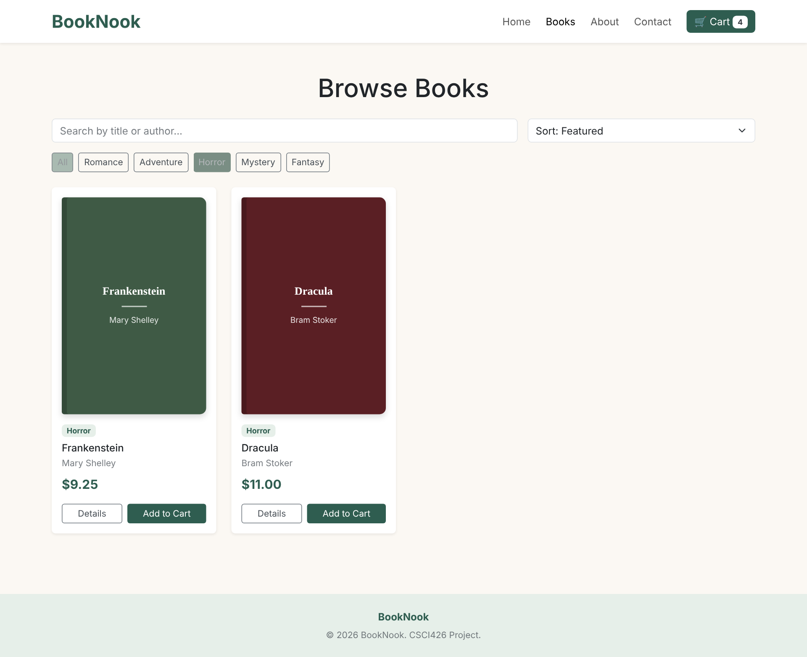
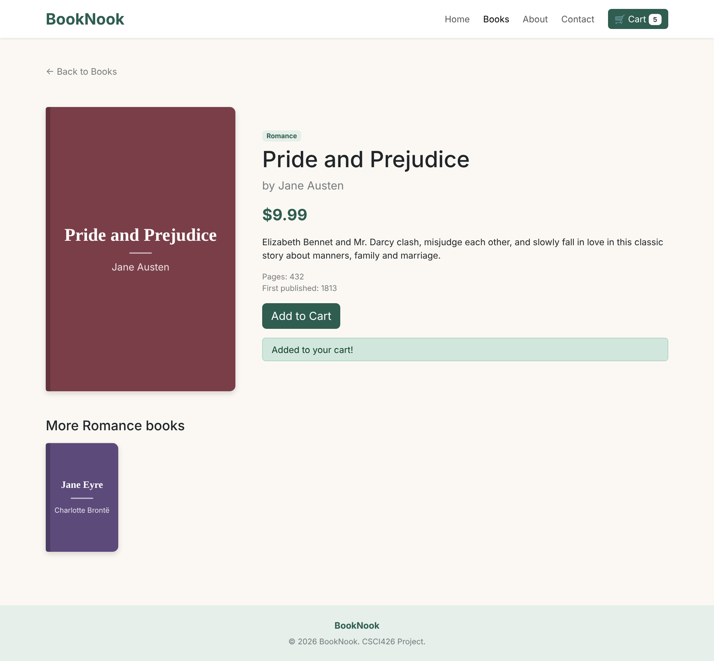
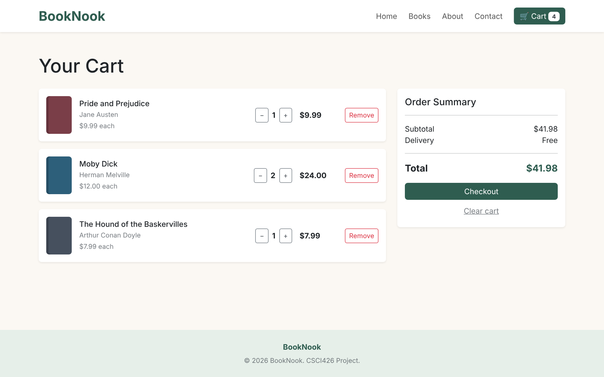
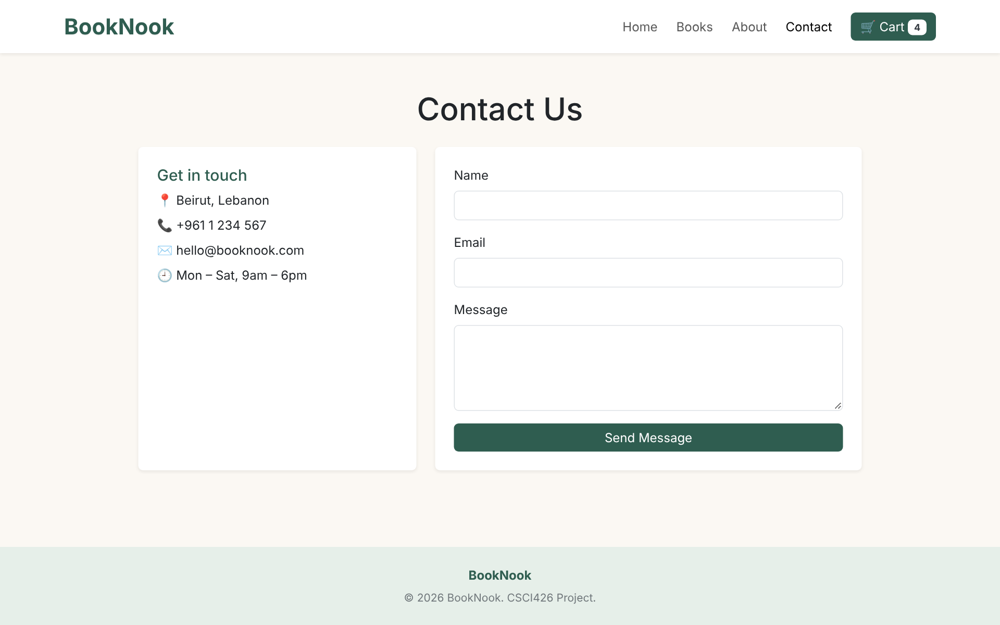
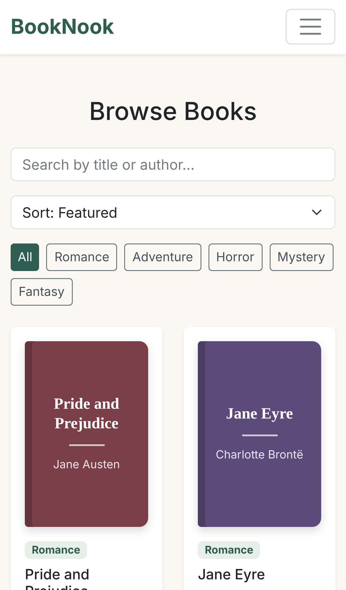

# BookNook – Online Bookstore

CSCI426 Advanced Web Programming – Project Phase 1
Student: Elya Semaan (92430097)

## Project Description

BookNook is a simple online bookstore built with **React** and **Bootstrap**.
Users can browse books, search by title or author, filter by genre, sort by price,
open a book details page, add books to a shopping cart, change quantities and
check out. The cart is saved in the browser (localStorage), so it stays after a refresh.

### Pages

| Page | Route | Description |
|------|-------|-------------|
| Home | `/` | Hero banner, features and featured books |
| Books | `/books` | All books with search, genre filter and price sort |
| Book Details (dynamic) | `/books/:id` | Details of one book, loaded from the URL id, plus related books |
| Cart | `/cart` | Cart items, quantity buttons, total and checkout |
| About | `/about` | Information about the store |
| Contact | `/contact` | Contact info and a contact form |

### Technologies Used

- React 18 (Vite)
- React Router DOM (routing)
- Bootstrap 5 (layout and responsive design)
- React Context API (shared cart state)
- Git & GitHub (version control)

## Setup Instructions

1. Install [Node.js](https://nodejs.org) (version 18 or newer).
2. Clone the repository:
   ```bash
   git clone https://github.com/<your-username>/booknook.git
   cd booknook
   ```
3. Install packages:
   ```bash
   npm install
   ```
4. Run the website:
   ```bash
   npm run dev
   ```
   Then open the link shown in the terminal (usually http://localhost:5173).

## Deployment (GitHub Pages)

```bash
npm run deploy
```

This builds the project and publishes the `dist` folder to the `gh-pages` branch.
Then in GitHub go to **Settings → Pages** and select the `gh-pages` branch.

Live demo: `https://<your-username>.github.io/booknook/`

## Screenshots

### Home


### Browse Books


### Book Details


### Cart


### Contact


### Mobile View


## Project Structure

```
src/
  components/   Navbar, Footer, BookCard, BookCover
  context/      CartContext (cart logic)
  data/         books.js (book list)
  pages/        Home, Books, BookDetails, Cart, About, Contact
  App.jsx       Routes
  main.jsx      Entry point
```
